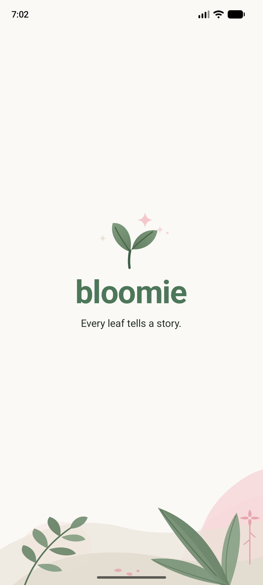
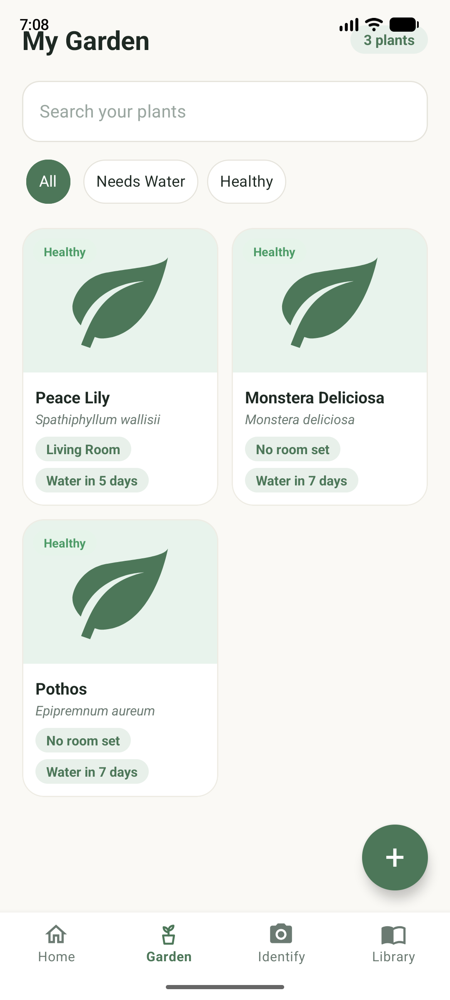
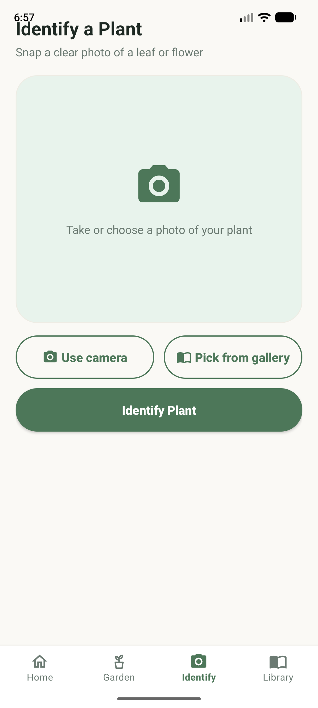
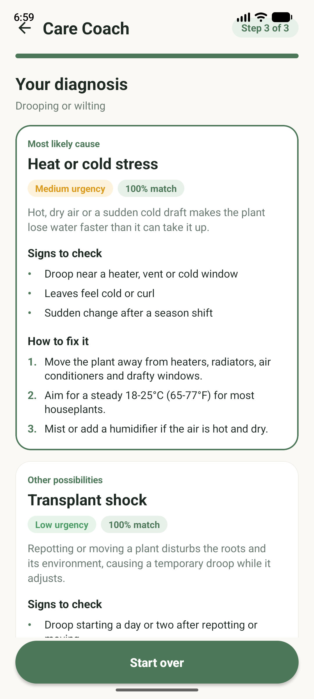

<div align="center">

  

  # 🌿 Bloomie
  **Every leaf tells a story — A Hybrid Android Plant Care Companion Powered by Local SQLite & the Pl@ntNet REST API**

  <p>
    
    
    
    
    
    <a href="LICENSE"></a>
  </p>

  <p>
    <a href="#-key-features">Features</a> •
    <a href="#-plant-identification-pipeline">Plant ID</a> •
    <a href="#-architecture--navigation-flow">Architecture</a> •
    <a href="#-screen-by-screen-guide">Screens</a> •
    <a href="#-database--storage-schema">Storage</a> •
    <a href="#-design-system">Design System</a> •
    <a href="#-screenshots">Screenshots</a> •
    <a href="#-current-limitations--future-roadmap">Limitations & Roadmap</a> •
    <a href="#-installation--setup">Setup</a>
  </p>

  <p>
    <i>Identify plant species online in seconds via camera or gallery, manage your personal garden offline in local SQLite storage, receive timely watering alerts, and diagnose leaf symptoms through a built-in Care Coach.</i>
  </p>

</div>

---

## 📖 Overview

**Bloomie** is a native Android plant care companion engineered in **Kotlin** with XML layouts and **ViewBinding**. Built around a **hybrid architecture**, it pairs **online Pl@ntNet REST API** integration for botanical species identification with **local SQLite persistence** so daily garden tracking, watering schedules, and symptom guidance work anytime without network dependency.

Designed around real-world indoor gardening habits, Bloomie combines **instant camera/gallery species identification**, **URI-based local photo persistence**, **automated background watering alarms**, and a **symptom-driven Care Coach** wrapped in a calm botanical design system.

---

## ✨ Key Features

### 📸 Plant Species Identification (`Pl@ntNet` API)
- **Camera & Gallery Capture:** Snap a live leaf or flower photo using `FileProvider` secure camera intents or pick an existing image from device storage inside `IdentifyFragment`.
- **Confidence-Scored Species Matches:** Sends multipart image requests over HTTPS via **Retrofit** to the **Pl@ntNet API**, displaying ranked botanical matches, scientific names, common names, and one-tap **Save to My Garden** actions in `IdentifyResultsActivity`.

### 🪴 Personal Garden Tracker & Offline Library
- **Curated Dashboard & Garden Grid:** `DashboardFragment` surfaces daily care priorities and due-soon reminders, while `GardenFragment` organizes saved plants with custom watering frequencies, light requirements, and temperature ranges—all stored locally on the device.
- **Disk-Backed Photo Storage:** User plant photos are saved to internal app storage and referenced as file URI strings in SQLite—avoiding heavy database `BLOB` overhead and keeping **Glide** image loading fast.
- **Built-In Botanical Reference (`assets/plants.json`):** `LibraryFragment` offers an offline plant encyclopedia with instant care profiles for popular houseplants.

### 💧 Smart Watering Schedule & Background Alarms
- **Automated Hydration Tracking:** Calculates `next_watering_date` dynamically from `last_watered_date` and `watering_frequency_days`, categorizing plants into overdue, due today, and upcoming in `ScheduleActivity`.
- **System Notifications (`WateringAlarmReceiver`):** Triggers scheduled Android notifications (`POST_NOTIFICATIONS`) so no plant goes unwatered, while logging every hydration event into `watering_history`.

### 🩺 Interactive Care Coach & Local Accounts
- **Rule-Based Symptom Diagnostics (`CareCoachActivity`):** Guides users through common leaf and soil symptoms (yellowing leaves, crispy tips, drooping, pests) using `CoachRule` models to provide actionable recovery advice offline.
- **Local Authentication (`LoginActivity` & `SessionManager`):** Supports offline account registration, credential verification in SQLite, and persistent login sessions across app restarts.

---

## 🧠 Plant Identification Pipeline

```text
User Photo (Camera via FileProvider / Device Gallery)
       │
       ▼
Multipart Image Compressor & URI Resolver (IdentifyFragment)
       │
       ▼
RetrofitClient ──► HTTPS POST to Pl@ntNet API (BuildConfig.PLANTNET_API_KEY) [Requires Internet]
       │
       ▼
Gson Parser (PlantNetResponse) ──► Ranked Species & Confidence Scores
       │
       ▼
IdentifyResultsActivity ──► [ Save to Garden ] ──► DatabaseHelper (Local SQLite) + Watering Alarm
```

---

## 🏗️ Architecture & Navigation Flow

**Bloomie** separates authentication, primary bottom-tab navigation (`MainActivity`), plant CRUD/inspection flows, and background alarm receivers into clean feature packages:

```text
App Launch
 ├── SplashActivity ─────────────► Botanical vector splash & session check (SessionManager)
 ├── WelcomeActivity ────────────► Brand introduction ("Discover. Care. Grow.")
 ├── LoginActivity ──────────────► Local SQLite Sign-In & Account Registration
 └── MainActivity ───────────────► BottomNavigationView Host
      ├── DashboardFragment ─────► Today's Care Overview • Due Waterings • Quick Shortcuts
      ├── GardenFragment ────────► User's Saved Plant Collection (Glide + Local SQLite)
      ├── IdentifyFragment ──────► Camera / Gallery Capture • Online Pl@ntNet Scan
      └── LibraryFragment ───────► Searchable Offline Botanical Guide (assets/plants.json)
           ├── IdentifyResultsActivity ─► Species Matches & One-Tap Garden Import
           ├── AddEditPlantActivity ────► Create / Edit Plant & Schedule Watering Alarm
           ├── PlantDetailsActivity ────► Full Care Specs, "Water Now" & History Log
           ├── ScheduleActivity ────────► Overdue, Today & Upcoming Hydration Timeline
           └── CareCoachActivity ───────► Interactive Plant Symptom & Recovery Assistant
```

---

## 📱 Screen-by-Screen Guide

| Screen | Class | Core Responsibilities |
| :--- | :--- | :--- |
| **Splash & Welcome** | `SplashActivity`, `WelcomeActivity` | Renders custom botanical vector art (`bg_splash_botanical`, `ic_bloomie_sprout`) and routes authenticated users straight to the dashboard. |
| **Authentication** | `LoginActivity` | Handles offline user registration and sign-in against the SQLite `users` table with `SessionManager` persistence. |
| **Care Dashboard** | `DashboardFragment` | Displays personalized greeting, plants needing water today, and quick access to the Schedule and Care Coach. |
| **My Garden** | `GardenFragment` | Lists user-owned plants from SQLite with Glide photo loading (`R.drawable.ic_leaf` fallback) and status badges. |
| **Plant Scanner** | `IdentifyFragment`, `IdentifyResultsActivity` | Captures or imports plant photos, queries `PlantNetApi` online, and converts top matches directly into saved garden entries. |
| **Botanical Library** | `LibraryFragment` | Parses `assets/plants.json` for offline browsing of common houseplants, light needs, and watering intervals. |
| **Plant Details & Editor** | `PlantDetailsActivity`, `AddEditPlantActivity` | Inspects care requirements, logs new waterings into `watering_history`, edits plant profiles, and sets alarm reminders. |
| **Schedule & Care Coach** | `ScheduleActivity`, `CareCoachActivity` | Organizes upcoming watering tasks chronologically and diagnoses plant health issues offline via `CoachRule` logic. |

---

## 🗄️ Database & Storage Schema

Bloomie splits local persistence across SQLite tables, bundled JSON assets, internal file storage, and `SharedPreferences`:

| Layer | Component | Storage Mechanism | Data Stored |
| :--- | :--- | :--- | :--- |
| **User Accounts** | `DatabaseHelper.kt` (`users`) | SQLite (`SQLiteOpenHelper`) | `id`, `name`, `email`, `password` |
| **Garden Collection** | `DatabaseHelper.kt` (`plants`) | SQLite (`SQLiteOpenHelper`) | `id`, `name`, `scientific_name`, `category`, `watering_frequency_days`, `last_watered_date`, `next_watering_date`, `light_requirement`, `temperature_range`, `image_path` *(internal URI)* |
| **Hydration Logs** | `DatabaseHelper.kt` (`watering_history`) | SQLite (`SQLiteOpenHelper`) | `id`, `plant_id` *(FK)*, `plant_name`, `watered_date` |
| **Reference Catalog** | `assets/plants.json` | Bundled JSON Asset | Offline encyclopedia entries (`LibraryPlant` models) with default `@drawable/img_welcome_plant` artwork |
| **Session State** | `SessionManager.kt` | `SharedPreferences` | Active user login state, user ID, display name, and email |

---

## 🎨 Design System

Built around a calm, organic botanical palette with high-contrast legibility and soft status pills:

| Token | Hex | Visual Role |
| :--- | :--- | :--- |
| `@color/bg_cream` | `#FAF9F5` | Warm botanical screen background |
| `@color/surface_white` | `#FFFFFF` | Elevated cards and form containers |
| `@color/sage_green` | `#4D7759` | Primary brand color, active tabs & pill CTAs |
| `@color/text_dark` | `#1E2923` | High-contrast botanical charcoal headings & body text |
| `@color/text_muted` | `#6E7A73` | Subtitles, metadata & input hints |
| `@color/badge_mint` | `#E8F3EC` | Healthy / optimal care status pills |
| `@color/badge_yellow` | `#FDF6E2` | Light requirement & due-soon tags |
| `@color/badge_blue` | `#EAF4FA` | Hydration & watering schedule badges |
| `@color/badge_peach` | `#FCEEE9` | Overdue watering & symptom alert badges |

---

## 📸 Screenshots

| Botanical Splash & Welcome | Care Dashboard & Garden | Plant Scanner | Plant Care Coach |
| :---: | :---: | :---: | :---: |
|  |  |  |  |

---

## 🚧 Current Limitations & Future Roadmap

While Bloomie delivers a complete local care loop alongside live Pl@ntNet identification, several architectural trade-offs and upcoming upgrades are planned:

| Current Limitation | Planned Update / Improvement |
| :--- | :--- |
| **Internet Required for Plant Scans:** Species identification relies on an active internet connection to send photos to the Pl@ntNet REST API. | **On-Device TensorFlow Lite Model:** Bundle a lightweight offline leaf classifier fallback so basic identification works without network access. |
| **Local-Only SQLite Storage:** User accounts, garden entries, and watering logs live strictly on a single device. | **Cloud Sync & Backup:** Integrate Firebase Authentication and Firestore/Room sync so users can restore their garden across devices. |
| **Static Rule-Based Care Coach:** Symptom troubleshooting relies on predefined `CoachRule` decision paths rather than visual leaf disease detection. | **Visual Leaf Disease Detection:** Extend camera scanning to detect common pests, fungal spots, and nutrient deficiencies directly from leaf photos. |
| **Alarm Persistence Across Reboots:** Scheduled `AlarmManager` notifications reset if the device restarts without a boot receiver. | **`BOOT_COMPLETED` Receiver & WorkManager:** Migrate reminders to `WorkManager` so watering schedules survive device reboots reliably. |
| **Single Light Botanical Theme:** Currently styled exclusively around the warm cream and sage-green palette. | **Adaptive Dark Botanical Mode:** Add a complete `values-night` deep-forest theme for comfortable evening care check-ins. |

---

## 📂 Project Structure

```text
Bloomie/
├── gradle/wrapper/                         # Gradle 9.6.0 wrapper
└── app/src/main/
    ├── AndroidManifest.xml                 # Activities, FileProvider & WateringAlarmReceiver
    ├── assets/
    │   └── plants.json                     # Offline houseplant reference dataset
    ├── java/com/example/bloomie/
    │   ├── data/db/
    │   │   ├── DatabaseHelper.kt           # SQLite tables & CRUD for users, plants & logs
    │   │   └── SessionManager.kt           # SharedPreferences session management
    │   ├── models/
    │   │   ├── Plant.kt                    # User garden plant model
    │   │   ├── WateringLog.kt              # Hydration history entry model
    │   │   ├── LibraryPlant.kt             # Offline JSON catalog model
    │   │   ├── PlantNetResponse.kt         # Retrofit/Gson Pl@ntNet API response DTOs
    │   │   └── CoachRule.kt                # Care Coach symptom & advice model
    │   ├── network/
    │   │   ├── PlantNetApi.kt              # Multipart Pl@ntNet REST endpoint definition
    │   │   └── RetrofitClient.kt           # Retrofit 3.0.0 + OkHttp logging client
    │   ├── notifications/
    │   │   └── WateringAlarmReceiver.kt    # BroadcastReceiver for watering notifications
    │   └── ui/
    │       ├── auth/                       # SplashActivity, WelcomeActivity, LoginActivity
    │       ├── main/                       # MainActivity, Dashboard, Garden, Identify & Library Fragments
    │       ├── details/                    # PlantDetails, AddEditPlant & IdentifyResults Activities
    │       └── assistant/                  # ScheduleActivity & CareCoachActivity
    └── res/
        ├── drawable/                       # Custom botanical vectors (ic_bloomie_sprout, bg_splash_botanical) & cards
        ├── layout/                         # ViewBinding XML screens & RecyclerView item layouts
        ├── menu/                           # BottomNavigationView menu
        ├── values/ & values-night/         # Color tokens, themes & typography
        └── xml/                            # FileProvider camera URI paths
```

---

## 🚀 Installation & Setup

### Prerequisites
- **Android Studio** Ladybug (2024.2.1) or newer
- **JDK 11+**
- **Android SDK** with Minimum API **24** (Android 7.0) and Target API **34+**
- **Pl@ntNet API Key** (free developer account at [my.plantnet.org](https://my.plantnet.org/))

### Steps to Run
1. **Clone the repository**
   ```bash
   git clone https://github.com/raniamezzi/Bloomie.git
   ```
2. **Configure your Pl@ntNet API Key**  
   Create or open `local.properties` in the root `Bloomie/` folder (excluded from Git) and add:
   ```properties
   PLANTNET_API_KEY="your_plantnet_api_key_here"
   ```
   *(Gradle automatically injects this key into `BuildConfig.PLANTNET_API_KEY` during compilation.)*
3. **Open in Android Studio & Sync Gradle**
   - Click **File → Open** and select the `Bloomie` root directory.
   - Wait for **Gradle 9.6.0** and dependencies (Retrofit 3.0.0, Glide 4.16.0, Material Components) to finish syncing.
4. **Run on Device or Emulator**
   - Connect a physical Android device (recommended for live camera scanning) or start an emulator with internet access, grant notification permissions when prompted, and press **Run (`▶`)**.

---

## 🎬 Recommended Demo Walkthrough

1. **Splash & Local Account Sign-In:** Launch Bloomie to showcase the custom botanical vector splash screen, create a local profile in **LoginActivity**, and allow notifications.
2. **Live Species Scan (Online):** Open the **Identify** tab, capture or select a plant photo, view the ranked **Pl@ntNet** scientific matches, and tap **Save to Garden**.
3. **Hydration Logging & Alerts (Offline):** Open **Plant Details** or **Schedule**, tap **Water Now** to record a new entry in `watering_history`, and trigger a live watering reminder notification.
4. **Care Coach & Library (Offline):** Open **Care Coach** to diagnose a sample leaf symptom offline, then browse the built-in **Library** catalog.

---

## 📄 License

Released under the **MIT License**. See [LICENSE](LICENSE) for full details.

<div align="center">
  Built with 💚 and <b>Kotlin</b> • Engineered for mindful, hybrid plant care.
</div>
